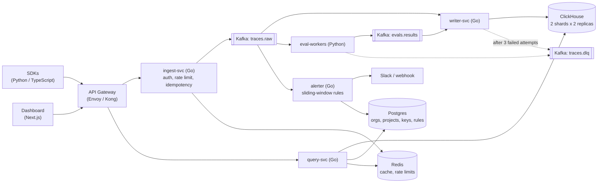

# rescan.ai: Distributed LLM Observability Platform

Team: Eugene Lacatis, Rosnita Dey, Robbie Tambunting, Lucas Nguyen

## Abstract

rescan.ai is an observability platform for applications built on large language models. An app sends
every LLM call (prompt, completion, model, tokens, cost, latency) to rescan through a lightweight Python
or TypeScript SDK. A Go ingest service accepts those traces and publishes them to Kafka. From there,
independent consumers write them to a sharded and replicated ClickHouse cluster, score them with
asynchronous eval workers (LLM-as-judge, toxicity, PII, latency), and watch sliding windows of cost,
error rate and p95 latency to fire alerts. A Next.js dashboard, served through an API gateway and a Go
query service, lets teams search traces, inspect sessions, chart cost and latency, and manage alert
rules.

The project demonstrates four distributed-systems concepts: message queues and stream processing
(Kafka, consumer groups, dead-letter queue), microservices behind an API gateway, replication and
sharding (ClickHouse 2 shards x 2 replicas, Kafka RF=3), and fault tolerance and scaling (idempotent
consumers, retries, Kubernetes autoscaling, chaos tests that kill a broker and a replica under load).

## Business Value

- **Cost control.** LLM API spend grows quickly and unevenly. rescan shows cost per project, model and
  request, and alerts on spikes before the monthly bill does.
- **Quality and safety.** Automated evals flag hallucinations, toxic output and leaked PII on real
  production traffic, not only in offline tests.
- **Faster debugging.** Engineers can open any user session and see the exact prompts, completions and
  latencies that led to a bad answer.
- **Reliability at scale.** The write path is built to absorb traffic bursts without losing data and
  without slowing down the customer's app, so teams can trace everything instead of sampling.
- **Multi-tenant by design.** Organizations, projects and API keys keep each team's data isolated,
  which is what a hosted SaaS product or an internal platform team needs.

## Proposed Architecture

## Proposed Technology

| Area | Technology |
|---|---|
| Hot-path services (ingest, writer, query, alerter) | Go, gRPC + HTTP |
| Eval workers | Python |
| Dashboard | Next.js (TypeScript) |
| Client SDKs | Python, TypeScript |
| Service contracts | Protocol Buffers (`buf`) |
| Event streaming | Apache Kafka (Strimzi operator, 3 brokers) |
| Trace and analytics storage | ClickHouse (ReplicatedMergeTree + Distributed tables) |
| Metadata | PostgreSQL |
| Caching and rate limiting | Redis |
| API gateway | Envoy or Kong |
| Orchestration | Kubernetes: kind locally, AWS EKS for the demo, Helm charts |
| Observability of the platform itself | Prometheus, Grafana, OpenTelemetry |
| CI/CD | GitHub Actions |
| Load and chaos testing | k6, broker/replica kill tests |
